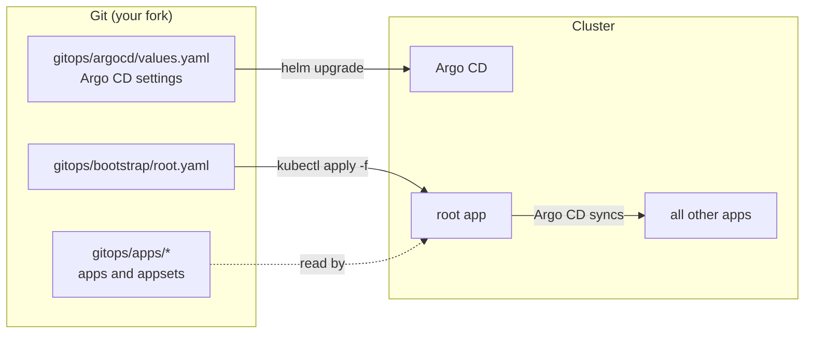

# Argo CD disaster recovery workshop

All your Argo CD Applications are gone. How long until everything is back?

In 10 minutes you run the same two apps twice, and lose them each time:

1. **ClickOps.** You create the apps in the UI and CLI. Then they are deleted, and you rebuild them from memory.
2. **GitOps.** The same apps, declared in this repository. They are deleted again, and you recover them with one command.



## What you need

- A GitHub account with Codespaces access.
- Basic Kubernetes knowledge. No prior Argo CD experience is needed.

## Steps

| Step | What you do | Time |
| --- | --- | --- |
| [Setup](docs/00-setup.md) | Fork, open a Codespace, point the manifests at your fork | during the intro |
| [1. ClickOps](docs/01-clickops.md) | Create two apps, lose them, rebuild by hand | 4 min |
| [2. GitOps](docs/02-gitops.md) | Set up from Git, change something, lose it all, recover | 4 min |
| [Wrap-up](docs/03-wrap-up.md) | What Git does not save you from | 2 min |

Facilitators: see [docs/facilitator.md](docs/facilitator.md).

## Repository layout

```text
gitops/
  argocd/values.yaml    Helm values for Argo CD, including its settings
  bootstrap/root.yaml   The root ("app of apps") Application, the only thing applied by hand
  apps/                 Every Application and ApplicationSet the root app manages
scripts/                Helpers behind the make targets
Makefile                Run `make help`
```
