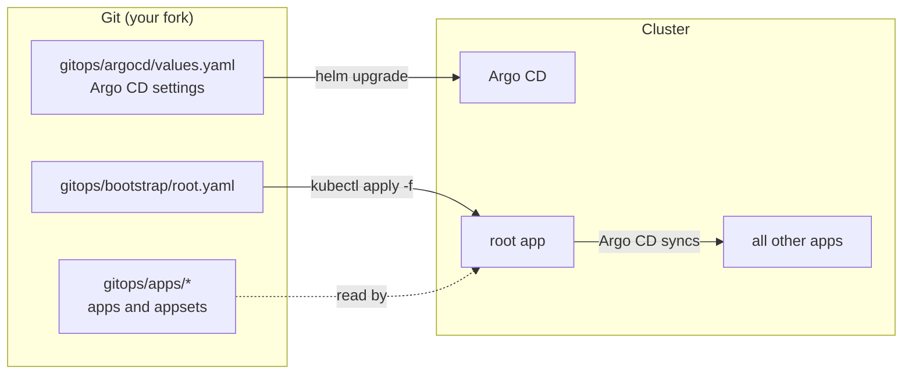

# Argo CD disaster recovery workshop

All your Argo CD Applications are gone. How long until everything is back?

In 10 minutes you run the same two apps twice, and lose them each time:

1. **ClickOps.** You create the apps in the UI and CLI. Then they are deleted, and you rebuild them from memory.
2. **GitOps.** The same apps, declared in Git. They are deleted again, and you recover them with one command.

## Start here

Do this now, while the intro is running. The setup takes a few minutes and runs in the background.

You need a GitHub account with Codespaces access.

### 1. Fork this repository

Select **Fork** at the top of this page, then **Create fork**.

Keep the fork **public**: Argo CD reads it without credentials, and the workshop does not set any up.

### 2. Create a Codespace on your fork

In your fork, select **Code** > **Codespaces**, then **...** > **New with options**. Choose:

| Setting | Value |
| --- | --- |
| Branch | `main` |
| Dev container configuration | **Argo CD disaster recovery workshop** |
| Machine type | 4-core |

Select **Create codespace**.

### 3. Open Part 1

When the Codespace opens, Part 1 should open automatically. If it doesn't, run this in the terminal:

```bash
code docs/01-clickops.md
```

Meanwhile, the setup installs the tools, creates a Kubernetes cluster and installs Argo CD. Part 1 starts by checking that it has finished.

## The steps

| Step | What you do | Time |
| --- | --- | --- |
| [1. ClickOps](docs/01-clickops.md) | Create two apps, lose them, rebuild by hand | 4 min |
| [2. GitOps](docs/02-gitops.md) | Set up from Git, change something, lose it all, recover | 4 min |
| [Wrap-up](docs/03-wrap-up.md) | What Git does not save you from | 2 min |

## How the GitOps part works



```text
gitops/
  argocd/values.yaml    Helm values for Argo CD, including its settings
  bootstrap/root.yaml   The root ("app of apps") Application, the only thing applied by hand
  apps/                 Every Application and ApplicationSet the root app manages
scripts/                Helpers behind the make targets
Makefile                Run `make help`
```

Facilitators: see [docs/facilitator.md](docs/facilitator.md).
